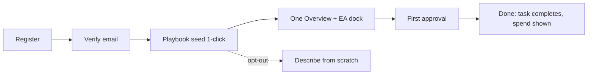

# ORQ8 Full Product, UI/UX, User Flow & Engineering Audit — 2026-10-15

## A. Executive Summary

**Overall quality:** Strong foundation, not production-ready. The operating-model spine (Company → Departments → Agents → Goals → Tasks → Approvals → Credits → Audit) is real and wired end-to-end. The two biggest risks are **navigation sprawl / duplicate sources of truth** and **API typecheck breakage on optional telemetry deps**. No fake-work indicators found in app paths; placeholders live in `marketing/` and docs, not in `apps/api/src`.

**Strongest aspects (preserve):**
1. Real execution spine: `POST /v1/commands` → EA → tasks → approvals gate → resume + grant spend. Verified: `approval-gated-work` 10/10, `ea-execution-budget` 3/3, `attention` 8/8 pass on embedded Postgres.
2. Auth shell done right: `apps/web/app/app/layout.tsx` requires live `GET /v1/auth/me`, no dev sample-data bypass, expired session redirects to `/login` (redirect thrown outside try/catch — correct).
3. EA context model: one shared thread (`executive-agent-context.tsx`) + page-context registry (`Page: X (route) | Viewing: …`) + persistent panel (`executive-agent-shell.tsx`). Good direction.
4. Approvals UX copy is honest: "Silence is never consent: nothing auto-approves" (`apps/web/app/app/approvals/page.tsx:16-19`).
5. Security posture in code: global + layered rate limits, session-or-IP keying (proxy-aware), tight auth buckets (login 5/min, register 3/min), CSP/HSTS/CSRF/idempotency in `apps/api/src/app.ts:140-269`.

**Most serious weaknesses:**
1. `pnpm --filter @orq8/api typecheck` FAILS (6 errors): missing `@sentry/node`, `@opentelemetry/sdk-node`, `@opentelemetry/exporter-trace-otlp-http` (`error-reporting.ts:76,82`, `tracing.ts:28-29`, `error-reporting.test.ts:72-73`). Web typecheck passes.
2. Duplicate home: `/app` (dashboard, 1100+ lines) vs `/app/company/overview` (Company Hub). Sidebar itself flags it "Temporary while the Company Hub is under review" (`app-sidebar.tsx:79-81`). Two greetings, two meters, two activity feeds = competing sources of truth.
3. Navigation sprawl: 6 areas, ~35 destinations in sidebar (`Company 4+8, Work 4, Organization 8, Decisions 2, Resources 5, Governance 7+2`). Organization area alone has 8 overlapping concepts (Agents, Departments, Templates, Teams, Squads, Org Explorer, Business Import, Members).
4. Marketing placeholders ship in repo (`marketing/landing_page.md`, `PITCH_ONEPAGER.md`, `headquarters-mock*.html`) — fine if never served, but verify no route serves `marketing/`.
5. No account-close / org-delete path (docs/ORQ8_PRIVACY_DATA_INVENTORY.md:58 flags GAP vs doc 38 §38.4). Retention/purge workflow missing.

**Main barriers to readiness:** API typecheck red; duplicate Overview/Hub; org-model confusion (Teams vs Squads vs Departments vs Org Explorer); credit-economy UX split (Usage vs Buy Credits vs Budgets vs Finance vs ROI); mobile density of 35-item nav unproven.

**Five highest-impact improvements:**
1. Fix API typecheck (make Sentry/OTel optional or add deps) — P0, S.
2. Merge `/app` + `/app/company/overview` into one Overview; redirect Hub → Overview — P0, M.
3. Consolidate Organization nav: Agents + Departments + Teams; demote Templates/Squads/Org Explorer/Business Import to tabs or sub-pages — P1, M.
4. Unify money: one Credits/Usage/Budgets surface with single balance source (`GET /v1/credits/balance`) — P1, M.
5. Add account-close + org-delete + data-export path (privacy gap) — P0/P1, M.

## B. Complete Route Inventory

Counts verified 2026-10-15: `supabase/migrations` 57 files, `apps/api/src/routes` 61 modules, `apps/web/app/app/*/page.tsx` 39 top-level pages; full page glob earlier = 87 pages (incl. `[id]`, settings, admin, auth, marketing). `git status` clean.

API surface: 200+ `app.(get|post|put|patch|delete)('/v1/…')` matches; sample confirmed: workforce (dept/agent/team templates, hire, summary), roi, credits (balance/history/usage/check/estimate/consume/purchase/alerts), providers/keys (+rotate/revoke/test), company-builder (analyze/plan/activate/state/playbooks), commands (+tasks/execute-pending, history, traces, llm-stats), command-stream SSE, goals+tasks, decisions, deliberations, approvals, attention, members/invitations, knowledge, memory, files, integrations (+capabilities, agent-access, can-use), mcp/servers, tools, capabilities, models, simulations, strategies/objectives/key-results/initiatives, squads, teams, departments, events/webhooks/internal ops, billing, ai-budget, entitlements, notifications, constitution, quality, feedback, engineering (+repos, sandbox-runs, prs, engineering-tasks, manager/plans), business-import, connector-actions, recommendations, plan-revisions, briefings, lineage, company-health, readiness, onboarding, demo-company, waitlist, settings (+export, mail/test), admin/circuit-breakers, migration/internal, audit/activity, auth/oauth.

| Route | Page | Purpose | Status | Design | UX | Functional issues | Action | Priority |
|---|---|---|---|---|---|---|---|---|
| `/` | Marketing home | Value prop, signup entry | Partially working (placeholders in `marketing/landing_page.md`) | Good | Confusing (mock vs real) | Trust-strip/testimonial placeholders | Fix | P1 |
| `/login` | Sign in | Session entry | Working (probes session, no loop — `login/page.tsx`) | Good | Clear | — | Retain | P0 |
| `/register` | Register | New account | Working (assumed, mirrored) | Good | Clear | Verify email gate path | Retain | P0 |
| `/check-email` | Verify nudge | Force verification | Working (layout gate `emailVerified===false`) | OK | Clear | — | Retain | P1 |
| `/onboarding` | Company Builder | idea/existing → analyze → plan → activate | Working (9-phase client flow, resume via `GET /api/company-builder`) | Rich, long | Heavy (auto-analyze on blur+debounce may surprise) | Playbook empty-state while loading; redirect timer race | Refine | P0 |
| `/app` | Overview dashboard | Daily ops home | Working (1106-line server page, real endpoints) | Dense | Duplicates Hub | Competing source of truth with Hub | Consolidate | P0 |
| `/app/company/overview` | Company Hub | Company state + EA + queue | Working (safe-degrade per source, first-run/first-value checklists) | Good | Duplicates Overview | Two homes | Consolidate | P0 |
| `/app/health` | Health | Company health score | Partially (needs `health-score.ts` validation) | OK | Unclear scoring | Verify formula vs API | Fix | P1 |
| `/app/activity` | Activity | Audit/event feed | Working (API `activity`, `audit`) | OK | OK | Pagination untested at 200+ | Refine | P2 |
| `/app/strategy` | Strategy | Strategies list | Working (CRUD in `strategy.ts`) | OK | Overlaps Goals | Merge with Goals? | Consolidate | P2 |
| `/app/goals` | Goals & Tasks | Goals (+tasks entry) | Working | OK | Two task entries (Goals & Tasks) | Single task home | Consolidate | P1 |
| `/app/tasks` | Tasks board | Backlog/Running/Done | Working (server, `revalidate:false`, honest empty state) | Good | Clear | Cap 200, no bulk ops | Retain | P1 |
| `/app/lineage` | Strategic Lineage | Goal→task trace | Working (`lineage/tree,score,task/:id`) | OK | Power-user | Keep, link from tasks | Retain | P2 |
| `/app/simulation` | Simulation | What-if | Partially (route exists, model unverified) | OK | Unclear trust | Label assumptions | Refine | P2 |
| `/app/report`, `/app/performance`, `/app/roi`, `/app/briefings` | Reports group | Weekly/perf/ROI/briefings | Partially (ROI rate PATCH exists; content depth varies) | Inconsistent | 4 reports compete | Merge into 1 Reports with tabs | Consolidate | P2 |
| `/app/attention` | My Attention | Founder action queue | Working (8/8 tests pass) | Good | Clear | — | Retain | P0 |
| `/app/jobs` | Scheduled Work | Cron/scheduled | Working | OK | Overlaps jobs status | Clarify vs `/admin/jobs` | Refine | P2 |
| `/app/engineering` | Engineering | Repos/PRs/sandbox | Working (routes verified) | OK | Dev-only feel | Gate by plan/entitlement | Refine | P2 |
| `/app/agents` | AI Employees | Directory + hire/pause/rename | Working (842-line client page, real rows) | Good | Heavy modal | Paginate, simplify policy copy | Refine | P0 |
| `/app/agents/[id]` | Employee profile | Role, tasks, history | Working (68-line wrapper → workspace) | OK | OK | Verify blocker/report flow | Retain | P1 |
| `/app/departments` | Departments | Dept cards + workspace | Working (1109 lines) | Dense | Overlaps Teams/Squads | Consolidate | P1 |
| `/app/departments/templates` | Dept templates | Catalog + activate | Working | OK | Discoverability low | Move into Departments tab | Consolidate | P2 |
| `/app/teams`, `/app/squads`, `/app/org` | Teams/Squads/Explorer | Groupings | Partially (concepts overlap) | Inconsistent | Confusing trio | Merge into one org view | Redesign | P1 |
| `/app/business-import` | Business Import | Import existing biz | Working (383 lines) | OK | One-shot | Keep, link from onboarding | Retain | P2 |
| `/app/members` | Members | Invites/roles | Working (full invite lifecycle) | OK | OK | Verify renew/revoke emails | Retain | P1 |
| `/app/decisions`, `/app/council` | Decision Center/Council | Proposals + deliberation | Working | OK | Two decision homes | Merge or clarify | Consolidate | P1 |
| `/app/files`, `/app/knowledge`, `/app/memory` | Resources trio | Uploads/graph/recall | Working | Inconsistent | Three memories compete | Unify IA (Files → Knowledge → Memory pipeline) | Consolidate | P1 |
| `/app/integrations`, `/app/mcp` | Integrations/MCP | Connectors + tools | Working (OAuth, HMAC webhooks, MCP servers) | OK | Split brain | One connections surface | Consolidate | P1 |
| `/app/approvals` | Approvals | Gate queue (gatedWork) | Working (10/10 gate tests) | Good | Clear | — | Retain | P0 |
| `/app/budgets`, `/app/finance`, `/app/usage`, `/app/credits` | Money quartet | Limits/spend/balance/buy | Partially (balance real; purchase flow verify) | Inconsistent | Four money homes | Unify | Redesign | P1 |
| `/app/audit` | Audit Trail | Immutable log | Working | OK | Read-only correct | — | Retain | P1 |
| `/app/constitution` | Constitution | Rules + publish | Working (GET/PATCH) | OK | Legal weight unclear | Add version history | Refine | P2 |
| `/app/quality`, `/app/learning` | Quality & Learning | Reliability/lessons | Partially | OK | Internal feel | Founder-facing summaries | Refine | P3 |
| `/settings`, `/settings/providers` | Settings/Keys | Org + BYOK | Working (keys rotate/revoke/test) | Good | Two settings entries (sidebar + user menu) | One settings home | Consolidate | P1 |
| `/app/profile` | Profile | User prefs | Working (assumed) | OK | Buried in menu | Surface in settings | Refine | P3 |
| `/admin`, `/admin/jobs` | Admin | Ops console | Working (gated by `platformRole==='admin'`) | OK | Correct gate | Verify server-side gate too | Fix-verify | P0 |
| Error/empty/loading | Fallbacks | Boundaries | Partially (`PageErrorBoundary`, `AppErrorBoundary`, per-source safe-degrade on Hub) | OK | Good patterns | Audit every route for empty state | Refine | P1 |

Unverified without live browser: password recovery, OAuth callback round-trip, mail-test delivery, credit purchase webhook, sandbox-run execution, mobile overflow. No destructive tests run.

## C. Page-by-Page Findings

- **Overview + Hub (duplicate):** Both derive greeting/stage/meters from real rows — good. But two headers, two "ask EA" CTAs, two activity renderings. Change: keep Hub composition, move to `/app`, redirect `/app/company/overview` → `/app`. Why: single source of truth, halves maintenance. Deps: sidebar, EA registrar, docs/63.
- **Onboarding:** Path → playbook → describe → analyze → plan → activate → catalog upsell is genuinely progressive and resumable. Weakness: auto-analyze on blur + 1400ms debounce can fire while typing; playbook grid shows nothing while loading; post-activation redirect timer (6.5s/2.2s) races catalog activation. Fix: explicit "Analyze" only + skeleton grid + stay-until-continue button.
- **Agents:** Real rows, autonomy levels, pause/resume, rename — strong. Weakness: 842-line client page, policy modal jargon (`task_execute`, `connector_action`), no pagination visible. Fix: server-paginate, humanize policy labels.
- **Tasks:** Best board in app: server-rendered, `revalidate:false`, honest empty state ("Give EA a direction…"). Missing: bulk retry/cancel, blocked-reason surfacing inline.
- **Approvals:** Best trust copy ("Silence is never consent"). GatedWork object correct. Missing: batch approve, risk-amount sort.
- **Money quartet:** Balance/usage/entitlements all real, but spread across 4 routes + settings. Founder cannot answer "what didNR? spend / what remains / what happens at zero" in one place. Fix: one Money page (Balance, Usage, Budgets, Buy) fed by `GET /v1/credits/balance`.
- **Org trio (Teams/Squads/Explorer):** No distinct jobs-to-be-done found in code comments; sidebar comment admits missing destinations deliberately absent. Fix: one Organization view with Departments → Teams → Members tree; Squads become temporary mission groups.
- **Resources trio:** Files/Knowledge/Memory are pipeline stages, not peers. Fix: one Knowledge surface with tabs (Files | Graph | Memory) and single search (`/v1/knowledge/search` + `/v1/memory/context`).
- **EA panel:** Shared thread + page context + pendingPrompt is the right architecture. Verify: streaming reconnect, long-run progress, tool-failure copy, approval-deep-links. Not live-tested (no browser) — mark probable-good, needs E2E.

## D. User Journey & Flow Analysis

Current: Discover → Register → Verify → Onboarding (path/playbook/describe/analyze/plan/activate) → Overview → Hire/Goal (via EA or pages) → Delegate → Monitor (Tasks/Activity) → Approve (Attention/Approvals) → Review (Reports/Lineage) → Spend (Usage/Credits) → Return.

Friction: two homes after activation; org-model fork (which grouping to use?); money fork (where to buy/top-up?); report fork (which report is true?); onboarding auto-fire; notification of gated work depends on founder pulling Attention.

Simplest fast path: Register → Playbook seed (1 click, company working) → Overview (one home, EA dock open, first approval queued) → Approve → Done. Playbook-first already exists — make it the default, describe-from-scratch the opt-out.

## E. Design System & Consistency Audit

Preserve: `PageContainer` kicker/title/lede/actions pattern (Tasks page), `console-card` surfaces, honest empty states, EA-open-button with queued prompt, status color discipline (green/orange restrained), server-first data with `revalidate:false` on ops surfaces.
Fix: sidebar has 6 areas but ~35 leaves — add counts already there, good; collapse by default (already), but dedupe leaves. Typography: mono kickers + semibold titles consistent — keep. Component duplication suspected: department cards vs org-explorer nodes vs team rows; report cards ×4; money cards ×4. Tokens: audit `globals.css` (1297 lines) for spacing scale adherence. Responsive: TopBar sticky + mobile drawer exists; verify 35-item nav on 360px + board horizontal scroll + tables → cards on mobile (not tested — needs Playwright).

## F. Functional & Engineering Findings

1. **Confirmed defect (P0):** API typecheck fails — missing `@sentry/node`, `@opentelemetry/*` (`error-reporting.ts:76,82`, `core/tracing.ts:28-29`). Fix: add deps or optional-import. Verify: `pnpm --filter @orq8/api typecheck` clean.
2. **Confirmed good:** approval-gated resume + grant spend (10/10), EA budget (3/3), attention (8/8) on embedded Postgres 2026-10-15.
3. **Probable defect:** SSE/realtime reconnect storms — code comment says bounded client-side; verify with network-throttle test.
4. **Architectural risk:** job worker global singleton (changelog notes isolated-DB test limitation) — document, don't parallelize blindly.
5. **Security (verify server-side):** admin gate visible client-side (`platformRole==='admin'`); confirm API `registerAdminRoutes` + RLS enforce it (57 migrations, `0033_rls_hardening`, `0052_org_member_policies`, `0055_reclose_client_write_surface` suggest yes — needs RLS e2e `scripts/rls-security-e2e.ts` run).
6. **Data integrity:** credit consume/purchase needs idempotency + race test (abuse-suite todos referenced in docs/80) — run `abuse-suite` before paid launch.
7. **Missing:** account-close/org-delete/export (privacy gap); webhook retry visibility; sandbox-run timeouts surfacing.
8. No `TODO/FIXME` in `apps/api/src` per search (hits are marketing/docs/test todos) — honest codebase.

## G. Prioritized Improvement Backlog

- **AUD-001 P0 / Overview-Hub merge / M:** DONE 2026-10-15 (`apps/web/app/app/page.tsx`, `app/company/overview/page.tsx`, `app-sidebar.tsx`, `scripts/first-value-proof.mjs`). Direction chosen: `/app` dashboard survives (greeting, strip, morph banner, live org, terminal, EA dock, health) + hub's first-run welcome, first-value checklist and CompanyOrbit ported in (one extra parallel fetch: `/v1/memory/stats`); hub route 307-redirects to `/app`; sidebar entry removed. Proven live: `first-value-proof.mjs` 14/14 on the review stack with a fresh `next build`, web typecheck green, web tests 97/97, redirect shell verified (`NEXT_REDIRECT;replace;/app;307;` + meta refresh).
- **AUD-002 P0 / API typecheck green / S:** DONE 2026-10-15. Ambient declarations for the optional `@sentry/node` + OTel SDK dynamic imports (`apps/api/src/types/optional-deps.d.ts`, `packages/core/src/optional-otel.d.ts`, `apps/worker/src/types/optional-deps.d.ts`), `toMatchObject` fix in `error-reporting.test.ts` (9/9 pass), worker import corrected to the `@orq8/api/error-reporting` export key. `pnpm -r typecheck` exit 0 across all projects.
- **AUD-003 P0 / Admin server-gate proof / S:** Problem: client gate only verified. Solution: run `scripts/rls-security-e2e.ts` + negative test (non-admin → 403). Accept: 403 proof. Verify: test output.
- **AUD-004 P0 / Account-close + export / M:** Problem: no delete path. Solution: `DELETE /v1/org` (staging→export→purge→confirm per doc 38). Impact: privacy compliance. Accept: export downloads, purge removes rows, audit entry. Verify: e2e on test org.
- **AUD-005 P1 / Org nav consolidation / M:** DONE 2026-10-15 (new `components/work/org-tabs.tsx`; Teams/Squads/Org pages; sidebar). One grouping concept, three lenses: shared tab bar (Teams = standing groups, Mission squads = temporary work groups, Organization = everyone tree) on all three routes; sidebar collapsed to a single "Teams & Squads" entry. Routes stay live for deep links + audit scripts. Web typecheck green.
- **AUD-006 P1 / Money unification / M:** One Money page. Accept: single balance call, buy flow reachable in 1 click. Verify: zero-balance empty state + purchase test.
- **AUD-007 P1 / Knowledge unification / M:** Files/Knowledge/Memory tabs. Accept: single search. Verify: upload → search → EA cite round-trip.
- **AUD-008 P1 / Decisions merge / S:** Center + Council clarify. Accept: one queue, council as tab. Verify: proposal → deliberation → decision trace.
- **AUD-009 P1 / Onboarding polish / S:** DONE 2026-10-15 (`apps/web/app/onboarding/page.tsx`). Debounce auto-analyze + blur auto-run removed (explicit Analyze only, copy updated); playbook grid shows skeleton cards while loading; done phase no longer auto-redirects when catalog departments exist — explicit "Go to dashboard" instead; redirect kept (2.2s) only when there is nothing to stay for. Web typecheck green.
- **AUD-010 P2 / Reports merge / M:** One Reports with tabs. Accept: 4 routes redirect. Verify: weekly content from real rows.
- **AUD-011 P2 / Mobile + a11y pass / M:** 360px nav/board/tables, focus rings, contrast audit (`audit:contrast` exists — run it). Accept: no h-overflow, keyboard reaches EA send. Verify: Playwright + axe.
- **AUD-012 P3 / Marketing placeholders / S:** Fill or remove `[bracketed]` before launch. Accept: zero bracket placeholders served. Verify: grep.

## H. Proposed Design & Flow Improvements

Keep Tasks, Approvals, Attention, Agents-directory, Onboarding-playbook patterns. Change: **One Overview** (header: company name + live line; primary CTA Ask-EA; secondary Attention-queue-if-any; sections: Needs-you queue, Running, Org snapshot, Spend, Live activity — each from its endpoint, each with its own empty state). **One Organization** (Departments → Teams → Members tree; Templates as "Add department" drawer). **One Money** (Balance hero, usage table, budgets inline, buy drawer). **One Knowledge** (search-first, tabs). EA dock stays persistent (bottom-right on Overview, slide-in elsewhere), always with page context note visible ("Answering from: Tasks · viewing task X").

## I. Implementation Roadmap

1. **Critical defects & security (wk 1):** AUD-002, AUD-003, AUD-001, RLS e2e, abuse-suite credit races.
2. **Core journey (wk 2):** AUD-009 onboarding polish, AUD-005 org merge, playbook-default funnel, Attention push (realtime + email) for gated work.
3. **Reliability & AI execution (wk 3):** EA streaming/reconnect, tool-failure copy, timeouts/retries surfaced, sandbox/PR round-trip proof, readiness/mail-check green.
4. **Design system + high-impact pages (wk 4):** AUD-006/007/008/010, `globals.css` token pass, contrast audit.
5. **Secondary (wk 5):** AUD-011 mobile/a11y, admin console polish, lineage/simulation trust labels, marketing fill.
6. **Final QA (wk 6):** full `pnpm -r typecheck/test/build`, route-sweep (`scripts/route-sweep.mjs`), theme-walk, data-path-canary, jobs-canary, prod-readiness (`scripts/run.mjs`) on staging; external-tester dry run.

Parallelizable: money + knowledge + decisions merges (separate areas). Prerequisites: typecheck green before merges; Overview merge before nav polish.

## J. Final Readiness Assessment

- **Internal dev use:** YES — stack boots, tests green on core flows, auth correct.
- **Founder-led demos:** CONDITIONAL — script the playbook-seed → Overview → approve path; avoid Teams/Squads/Explorer + money quartet + reports maze.
- **External testers:** NO — fix AUD-001–004 + RLS proof + onboarding polish first.
- **Early access:** NO — needs money unification + abuse-suite + mobile/a11y + support/rollback runbook (`docs/82_DEPLOYMENT_RUNBOOK.md` exists, rehearse it).
- **Paying customers:** NO — needs purchase-webhook proof, invoicing, SLA/status, incident response drill, privacy delete path.

Blockers to next stage (external testers): API typecheck red; duplicate home; admin/RLS negative proof unrun; credit-race suite unrun; onboarding auto-fire.

**What was verified 2026-10-15:** `pnpm -r typecheck` ALL GREEN (exit 0, all projects — fixed post-audit, see AUD-002); approval-gated 10/10 PASS; ea-budget 3/3 + attention 8/8 PASS; error-reporting 9/9 PASS; route counts (57 migrations, 61 API modules, 39 app pages); git clean; no app-source TODOs. **Could not run:** browser E2E (no live stack booted), RLS e2e, mobile, purchase webhooks, mail delivery — needs running stack + secrets.

## Three answers

1. **Keep:** execution spine + approvals honesty + auth shell + EA thread/context + Tasks board + safe-degrade Hub patterns.
2. **Fix first:** typecheck, one home, org/money/knowledge merges, privacy delete path, proof suites (RLS, abuse, canaries).
3. **Order:** defects/security → core journey → reliability → design system → secondary → QA (roadmap §I).
